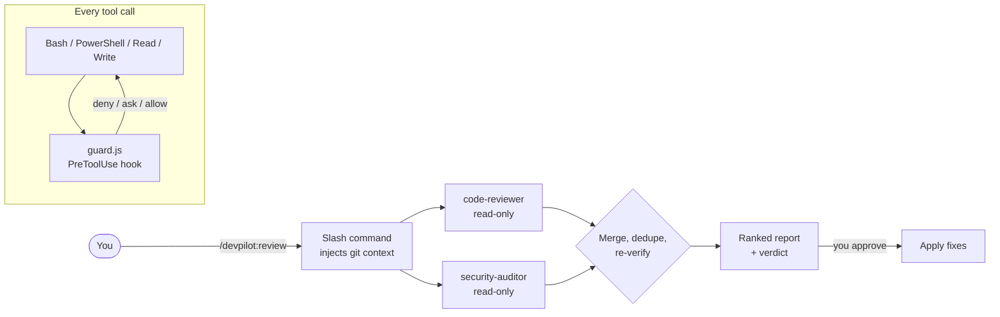

<div align="center">

# 🛩️ DevPilot

**An AI engineering teammate for [Claude Code](https://claude.com/claude-code).**

Specialist subagents, one-command workflows and a safety guard. Review, test, debug, document and ship code the way a senior engineer would.

[](https://github.com/Milindpatel/devpilot/actions/workflows/ci.yml)
[](LICENSE)


</div>

---

## Why DevPilot?

AI coding assistants are fast but tend to be overconfident: reviews full of speculative nitpicks, "fixes" that hide symptoms, tests that can't fail, and the occasional `rm -rf` in the wrong place. DevPilot packages proven engineering practice into Claude Code so the assistant behaves like a careful senior teammate:

- **🎯 Verify before reporting.** Reviewers must trace each finding to real code and try to disprove it before reporting it.
- **🔬 Root cause, not symptoms.** The debugger reproduces the failure, tests hypotheses and proves the fix with a regression test.
- **⚡ Parallel specialists.** `/devpilot:review` runs a correctness reviewer and a security auditor at the same time, then merges and re-checks what they found.
- **🛡️ Safe by default.** A zero-dependency hook blocks catastrophic commands and asks before risky ones.
- **🙋 Human in the loop.** Nothing is committed, pushed or published without your explicit approval.

## Features

### Slash commands

| Command | What it does |
|---|---|
| `/devpilot:review [path\|branch\|PR#]` | Multi-agent review (correctness + security) merged into one ranked report with a verdict |
| `/devpilot:ship [note]` | Pre-flight checklist: secrets check → tests → lint → review → Conventional Commit. Asks before committing |
| `/devpilot:fix <error\|issue#>` | Root-cause debugging from an error, failing test or GitHub issue, with a regression test |
| `/devpilot:test [target]` | Generates meaningful tests in your project's framework and style, then runs them |
| `/devpilot:onboard [focus]` | Writes `ONBOARDING.md`: architecture diagram, key files, how to run, conventions |
| `/devpilot:pr [base]` | Writes a reviewer-friendly PR description (What / Why / How / Testing / Risk) |
| `/devpilot:explain <thing> [level]` | Explains a file, symbol or error, with `file:line` references and history |

### Specialist subagents

Claude delegates to these automatically when they fit, or you can ask for one by name (*"use the security-auditor on src/api"*).

| Agent | Role | Tools | Model |
|---|---|---|---|
| `code-reviewer` | Correctness-first review, severity-ranked, verified findings | read-only | inherit |
| `security-auditor` | OWASP / CWE data-flow audit, secret scanning, dependency audit | read-only | inherit |
| `test-engineer` | Writes deterministic tests that match house style, and runs them | read + write | inherit |
| `debugger` | Reproduce → hypothesise → prove → minimal fix → regression test | read + write | inherit |
| `codebase-explorer` | Fast architecture map with Mermaid diagram and key files | read-only | haiku (fast, cheap) |
| `docs-writer` | READMEs, ADRs, changelogs, docstrings, verified against the code | read + write | inherit |

### Skills (applied automatically)

- **`conventional-commits`**: commit messages that follow Conventional Commits 1.0 *and* the repo's existing style.
- **`secure-coding`**: guardrails applied while writing code that touches input, auth, SQL, shell, files, secrets or HTTP.

### 🛡️ Safety guard (PreToolUse hook)

Runs before every `Bash`, `PowerShell`, `Read`, `Edit` and `Write` call. It understands chained commands (`&&`, `;`, `|`), `sudo`/`env` prefixes, nested `bash -c "…"`, and both Unix and Windows syntax.

| Decision | Examples |
|---|---|
| ⛔ **Deny** | `rm -rf /` · `rm -rf ~` · `Remove-Item -Recurse C:\` · `find / -delete` · `git push --force origin main` · deleting `main` on the remote · `mkfs` · `dd of=/dev/sda` · fork bombs · `chmod -R 777 /` |
| ✋ **Ask** | `rm -rf .` · `git reset --hard` · `git clean -fd` · `git checkout -- .` · `git branch -D` · force push to feature branches · `curl … \| bash` · `npm publish` / `docker push` · `DROP TABLE` · reading or writing `.env`, private keys or cloud credentials |
| ✅ **Allow** | Everything else, e.g. `rm -rf node_modules`, `git push -u origin main`, `cat .env.example` |

Its decisions are covered by **72 tests**. If the hook receives input it can't parse, it fails open and leaves the decision to Claude Code's own permission system. Disable it for a session with `DEVPILOT_GUARD=off`.

## Quick start

**Requirements:** [Claude Code](https://docs.claude.com/en/docs/claude-code) and Node.js 16+ (used by the safety hook).

### Install from GitHub

In Claude Code:

```
/plugin marketplace add Milindpatel/devpilot
/plugin install devpilot@devpilot-marketplace
```

Restart Claude Code, then type `/devpilot:` to see the commands.

### Try it locally without installing

```bash
git clone git@github.com:Milindpatel/devpilot.git
```

```bash
claude --plugin-dir ./devpilot/plugins/devpilot
```

## Usage examples

```text
> /devpilot:review
  Verdict: REQUEST CHANGES
  | # | Severity   | Location              | Problem                                   | Fix                         |
  | 1 | 🔴 Critical | src/api/users.ts:42   | SQL built with template string (CWE-89)   | Use parameterised query     |
  | 2 | 🟠 High     | src/auth/session.ts:18| Token expiry never checked                | Verify `exp` before use     |
  ...

> /devpilot:fix "TypeError: Cannot read properties of undefined (reading 'id')"
  Root cause: getUser() returns undefined for soft-deleted users; the caller assumed non-null.
  Evidence:   Reproduced with user 1093 (deleted_at set); failing test added.
  Fix:        src/services/orders.ts: guard + 404; 3 call sites updated.
  Verified:   npm test -- orders → 48 passed.

> /devpilot:ship "add magic link login"
  ✅ No secrets staged   ✅ Tests (212 passed)   ✅ Lint   ✅ Review: no blockers
  Proposed commit:
    feat(auth): add passwordless login via magic link
  Commit these 6 files? (yes/no)
```

*(Illustrative output; the exact wording depends on your codebase.)*

## How it works



DevPilot is built from four Claude Code extension points:

| Extension point | Where | Purpose |
|---|---|---|
| **Subagents** | `plugins/devpilot/agents/*.md` | Focused specialists with their own context window, tool allow-list and model |
| **Slash commands** | `plugins/devpilot/commands/*.md` | Repeatable workflows; `` !`git …` `` injects live repo context before the prompt runs |
| **Skills** | `plugins/devpilot/skills/*/SKILL.md` | Knowledge Claude loads on demand when the task matches |
| **Hooks** | `plugins/devpilot/hooks/` | Deterministic code that runs outside the model, for guarantees a prompt can't give |

### Design decisions

- **Least privilege.** Reviewers, auditors and explorers get read-only tools, so they can't "fix" things behind your back.
- **Precision over recall.** Every reviewer has to try to disprove its own findings, which cuts the false positives that make people ignore AI reviews.
- **Right model for the job.** Exploration runs on Haiku for speed and cost, while reasoning-heavy agents inherit your main model.
- **Deterministic safety.** A hook is code rather than a prompt, so a model can't be talked out of it. It has no dependencies, can be tested in isolation, and fails open so a bug in it can't lock you out.
- **Explicit approval for outward actions.** Commit, push, PR creation and publishing always wait for a yes from you.
- **Lightweight.** The whole plugin adds only **~900 tokens** to each session. Agent and skill bodies load only when they're used, and the hook costs no model context at all (measured with `claude plugin details devpilot`).

## Project structure

```
devpilot/
├── .claude-plugin/
│   └── marketplace.json        # Makes this repo an installable marketplace
├── plugins/devpilot/
│   ├── .claude-plugin/
│   │   └── plugin.json         # Plugin manifest
│   ├── agents/                 # 6 specialist subagents
│   ├── commands/               # 7 slash commands
│   ├── skills/                 # 2 auto-applied skills
│   └── hooks/
│       ├── hooks.json          # PreToolUse registration
│       └── guard.js            # Safety guard (zero dependencies)
├── tests/guard.test.js         # 72 tests for the guard
└── .github/workflows/ci.yml    # Tests + manifest validation
```

## Development

```bash
npm test
```

```bash
claude plugin validate ./plugins/devpilot
```

To add an agent, command or skill, drop a Markdown file into the matching folder, then run the validator. See [CONTRIBUTING.md](CONTRIBUTING.md).

## Roadmap

- [ ] `evals/` suite using `claude plugin eval` to score review precision on seeded-bug fixtures
- [ ] `/devpilot:perf`: profiling-driven performance investigation agent
- [ ] Optional MCP integrations (issue trackers, CI logs)
- [ ] Configurable guard policy (`.devpilot.json`) for team-specific protected branches

## License

[MIT](LICENSE) © Milind Patel
